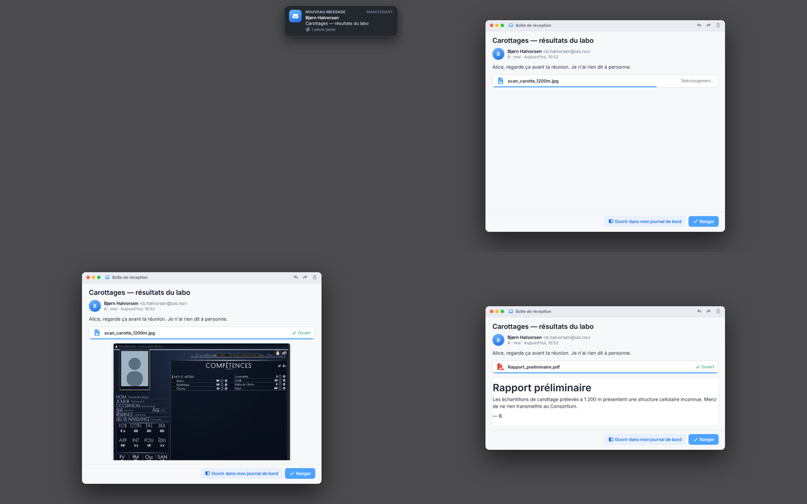
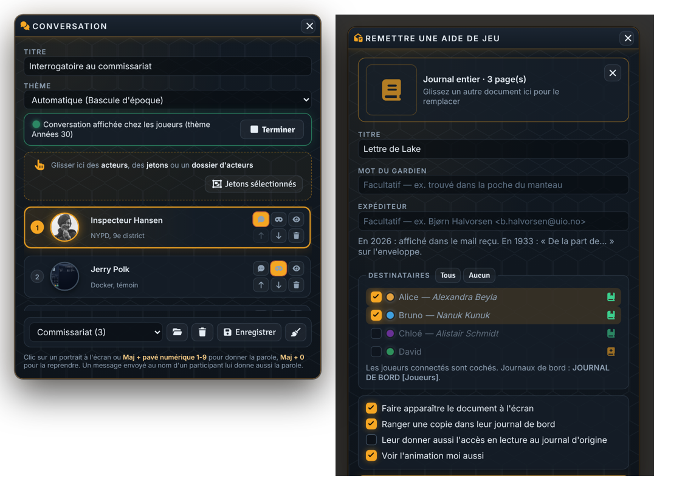

# Distribution d'aides de jeu

Module Foundry VTT (v13 / v14) pour remettre une aide de jeu aux joueurs, d'un geste.

- **Le Gardien choisit un document** : il glisse une page ou un journal, une tuile ou un acteur (son image), ou choisit une image sur le disque.
- **Il coche les destinataires** (les joueurs connectés sont cochés d'office) et ajoute s'il veut un mot (« trouvé dans la poche du manteau »).
- **Chez les joueurs, le document apparaît** avec une animation : en 1933, une enveloppe kraft scellée à la cire ; en 2025-2026, une notification « Nouveau message », puis le mail s'ouvre (expéditeur, objet, mot du Gardien) et la pièce jointe se télécharge et s'affiche. Le champ facultatif **Expéditeur** (« Nom <adresse> ») remplit le mail en 2026 et ajoute « De la part de… » sur l'enveloppe en 1933. Le style suit le module *Bascule d'époque* s'il est actif.
- **Le joueur peut choisir lui-même** : avec la coche « Laisser le joueur choisir de la ranger ou non », la missive arrive avec deux boutons, « Ranger dans mon journal de bord » et « Ne pas ranger ». Rien n'est rangé tant qu'il n'a pas choisi, et le Gardien en garde la trace dans le chat. Si le Gardien recharge sa page avant le choix, la remise est perdue (il suffit de la remettre).
- **Une copie se range dans leur journal de bord** (un journal par joueur, dont il est propriétaire, dans le dossier « Journal de bord… »). Le module le crée s'il manque.
- **Deux époques, deux carnets** : une aide de jeu rangée sous un dossier « 2026 » va dans le **carnet de bord** du joueur (dossier « Carnet de bord… »), une aide sous « 1933 » dans son **journal de bord**. L'époque est détectée toute seule et reste modifiable dans la fenêtre ; l'animation suit (enveloppe ou mail).
- **Une trace** part en message privé dans le chat (Gardien + destinataires).

## Zoom sur les images (ex-module « Zoom & Pan sur les images »)

Sur toute fenêtre d'image (clic sur une image de journal, aperçu d'image) et dans l'apparition d'une aide de jeu :
- molette : zoom centré sur le curseur ; clic-glissé : déplacement ; double-clic : vue d'origine ;
- simple clic : ping animé à votre couleur, visible par ceux qui regardent la même image ;
- bouton antenne (Gardien) : force votre zoom et votre cadrage chez tous les joueurs (ouvre l'image chez eux si besoin).
Si l'ancien module « Zoom & Pan sur les images » est encore actif, il garde la main (pas de double barre) : désactivez-le.

- **Depuis une image affichée** : le Gardien voit, dans la barre de zoom de toute fenêtre d'image (loupes, antenne), une enveloppe « Remettre aux joueurs (missive) ». Elle ouvre la fenêtre de remise avec cette image et son titre déjà choisis.
- **Avec Handout Ping Viewer ou l'ancien Zoom & Pan actifs** : leur barre de zoom garde la main (pas de double barre ni de double ping) et le module y ajoute seulement l'enveloppe « Remettre aux joueurs ». Pour tout avoir dans un seul module, désactivez-les.
## Ouvrir la fenêtre

- Barre de gauche, outils des jetons : icône enveloppe.
- Clic droit sur un journal du répertoire : « Remettre aux joueurs… ».
- Menu ⋮ d'un journal ouvert : « Remettre aux joueurs… » (remet la page affichée).
- Macro : `game.modules.get("distribution-aides-de-jeu").api.open()`.

## Réglages

Dossier des journaux de bord, création automatique, style de l'animation (automatique / années 30 / moderne), trace dans le chat, son à la réception.

Le module utilise un canal réseau (socket) : après l'avoir activé, **relancez le monde** (retour au menu puis lancement), un simple F5 ne suffit pas.

Licence MIT. Polices Limelight, Rajdhani (OFL) et Inter (OFL).

## Aperçus

